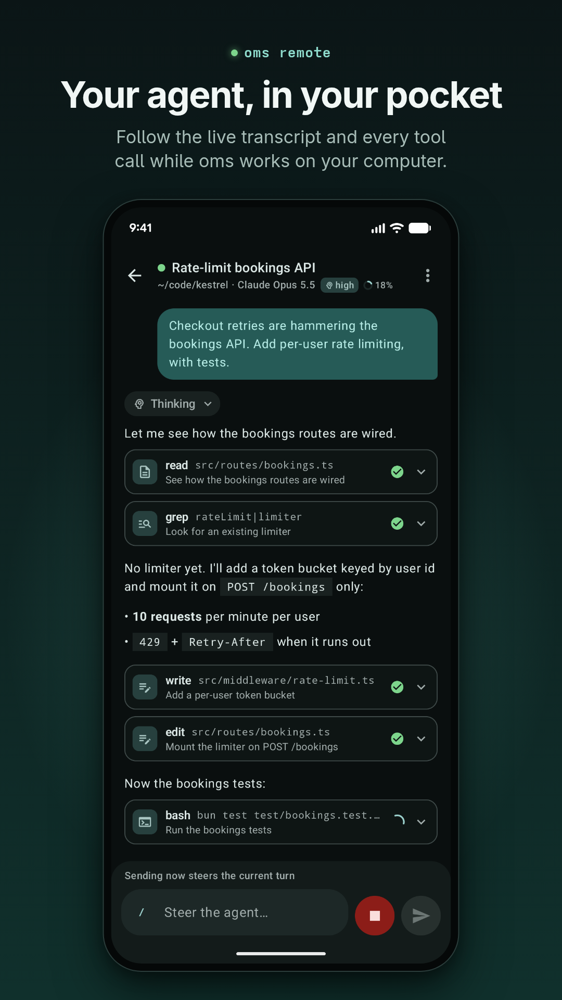
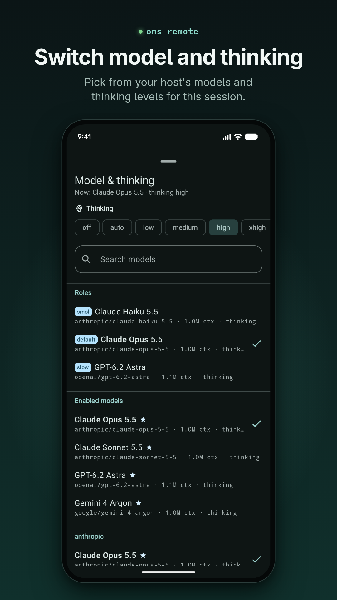
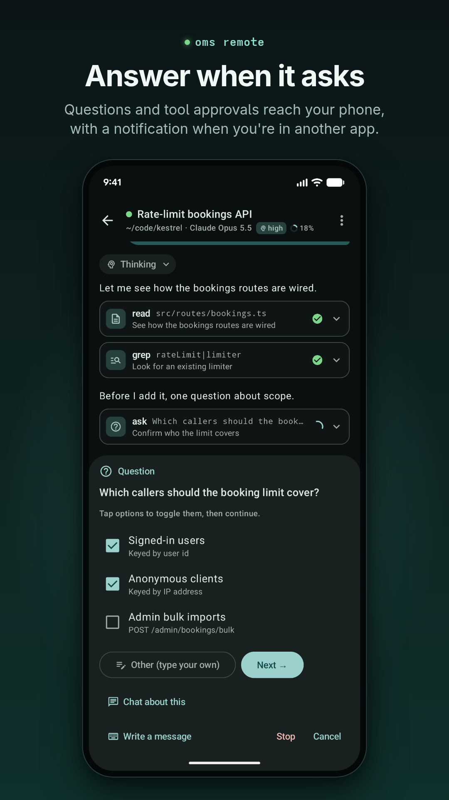

<h1 align="center">oms remote</h1>

<p align="center">
  Follow, steer and control a running <a href="https://github.com/pickpocket/oh-my-soup">oms</a> coding-agent session from your Android phone.
</p>

<p align="center">
  
  &nbsp;
  
  &nbsp;
  
</p>

oms remote joins an oms session as a collab guest over the session's end-to-end encrypted link. You
get the live session on your phone and can step in when the agent needs you, without sitting at the
computer.

## What it does

- **Live session.** The transcript streams in as oms works: thinking, tool calls with their output,
  context usage, and the current model.
- **Steer and stop.** Send prompts from the phone. A message sent mid-turn steers the current turn;
  Stop interrupts it.
- **Questions and approvals.** The agent's questions and tool approvals show up on the phone. While
  the app is in the background you get a notification, with Approve and Deny buttons for approvals.
- **Slash commands.** Run the host's slash commands with argument completions, switch model and
  thinking level from a picker, and rewind to an earlier prompt.
- **Subagents.** See what each subagent is doing, message it, kill it or revive it.
- **Watch-only links.** A view link shows everything and changes nothing.

More screenshots are in [`docs/screenshots`](docs/screenshots).

## Requirements

- Android 10 or newer.
- oms with collab protocol v5 (18.20.3 or newer) for slash commands. Older hosts still connect,
  without them.
- Some controls need a newer oms than the current release, such as the full model list and rewind.
  The app hides a control, or falls back to the host's commands, when the host doesn't offer it.

## Getting started

1. **Install the app.** There are no releases yet: [build it](#building), or download the
   `oms-remote-debug` artifact from the latest CI run.
2. **Share the session.** Run `/collab` in oms. On the default relay it prints a QR code; scan it in
   the app, or paste the link (`oms join "<link>"` works as-is). Use `/collab view` for a
   read-only link.
3. **Reach the relay.** The phone connects to the same relay as oms. The default relay
   (`wss://my.omp.sh`) works from anywhere. A self-hosted relay must be reachable from the phone,
   for example over a private VPN, or over USB with `adb reverse tcp:<port> tcp:<port>`.

The app keeps the session connected in the background, and saved hosts are one tap away on the
home screen.

## Security

- A **full link** carries the room's AES-256-GCM key plus a write token: whoever has it can prompt
  your agent. Treat it like a password, and use `/collab view` when someone only needs to watch.
- Session traffic is encrypted end to end between oms and the app. The relay only forwards
  ciphertext.
- Saved links are encrypted on the phone with a key held in the Android Keystore, so a copied
  preferences file is useless on another device.

## Building

You need JDK 17 or newer and the Android SDK (platform 37).

```sh
./gradlew :protocol:test        # protocol unit tests (plain JVM, no device needed)
./gradlew :app:assembleDebug    # -> app/build/outputs/apk/debug/app-debug.apk
adb install -r app/build/outputs/apk/debug/app-debug.apk
```

## Project layout

```
app/                  Android app: Compose UI, background session service, notifications, QR pairing
  src/debug/          debug-only demo screens used for the screenshots
protocol/             collab v5 client in plain Kotlin: links, encryption, frames, session state
docs/
  collab-v5-spec.md   the wire protocol the app speaks
  collab-vectors.mjs  regenerates the protocol test vectors
  screenshots/        store screenshots
tools/screenshots/    scripts that capture and frame the screenshots
```

The `protocol` module has no Android dependencies, so the whole collab client is unit-tested on the
JVM. [`docs/collab-v5-spec.md`](docs/collab-v5-spec.md) describes every frame it handles.

## License

[MIT](LICENSE)
